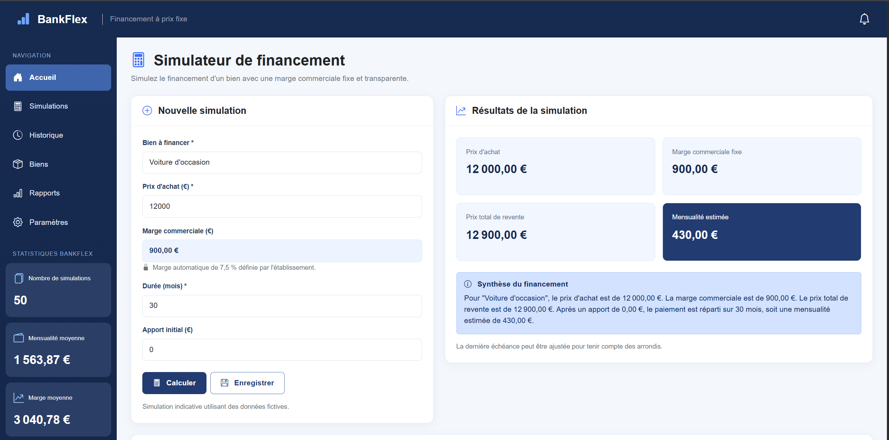
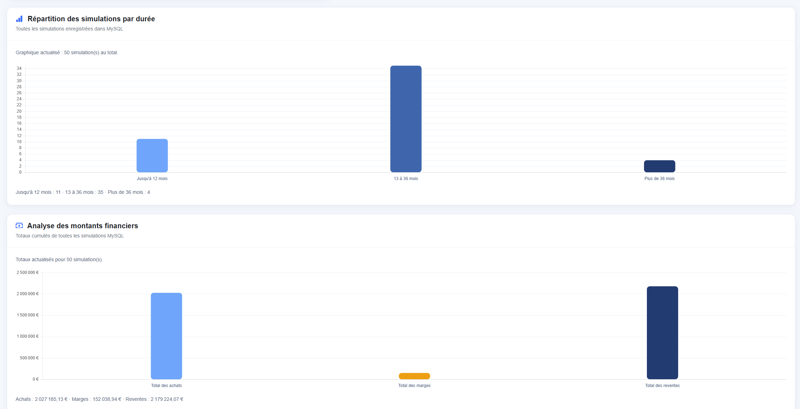
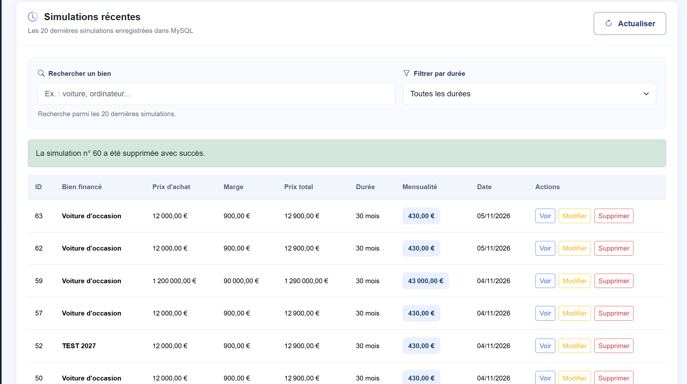

# BankFlex — Simulateur de financement à prix fixe

**BankFlex** est une application web pédagogique permettant de simuler l'achat-revente d'un bien avec un **prix de revente fixé dès le départ**. Elle calcule les montants, enregistre les simulations dans MySQL et présente un tableau de bord statistique interactif.

> **Projet éducatif :** BankFlex utilise des données fictives. Il ne constitue ni une offre de financement, ni un service financier, ni un modèle contractuel ou réglementaire prêt à être commercialisé. Toute application réelle nécessiterait une analyse juridique et réglementaire adaptée.

## 🖥️ Aperçu de l'application





## Fonctionnalités

- Simulation à partir du nom du bien, du prix d'achat, de la durée et de l'apport initial.
- **Marge commerciale fixe de 7,5 % du prix d'achat**, calculée une fois pour déterminer le prix total de revente ; ce n'est pas un calcul d'intérêts périodiques.
- Calcul du prix de revente, du montant restant après apport et de la mensualité estimée, avec prise en compte des arrondis au centime.
- Enregistrement des simulations dans MySQL.
- Consultation, modification avec recalcul et suppression avec confirmation (**CRUD**).
- Historique des **20 dernières simulations**, recherche par nom du bien et filtres par durée.
- Indicateurs : nombre total de simulations, mensualité moyenne et marge moyenne.
- Deux graphiques dynamiques : **répartition des simulations par durée** et **montants financiers cumulés** (achats, marges, reventes).
- Interface responsive en français avec Bootstrap.

## Technologies

| Couche | Technologies |
|---|---|
| Interface | HTML5, CSS3, JavaScript, Bootstrap 5, Bootstrap Icons |
| Graphiques | Chart.js |
| Serveur et API | Node.js, Express |
| Base de données | MySQL 8, `mysql2/promise` |
| Configuration | `dotenv` |
| Versionnement | Git et GitHub |

Bootstrap et Chart.js sont chargés depuis des CDN : une connexion Internet est nécessaire pour charger ces bibliothèques lors de l'ouverture de l'interface.

## Organisation du projet

```text
bankflex-financement/
├── public/
│   └── index.html          # Interface, simulateur et graphiques
├── sql/
│   ├── 1_Création base de données MySQL.sql
│   └── 2_Table simulations.sql
├── server.js               # Serveur Express et API
├── package.json            # Dépendances Node.js
├── package-lock.json       # Versions verrouillées des dépendances
├── .gitignore              # Exclusions Git
└── README.md               # Documentation
```

Le fichier `.env` et le dossier `node_modules/` sont utilisés localement et ne doivent pas être publiés dans le dépôt.

## Installation en local

### Prérequis

- Node.js et npm (par exemple Node.js 20 ou plus récent).
- MySQL Server 8 et MySQL Workbench.
- Un terminal PowerShell dans Visual Studio Code.

### 1. Récupérer le projet

```powershell
git clone https://github.com/datasifaw/bankflex-financement.git
cd bankflex-financement
```

Si le projet est déjà présent sur l'ordinateur, il suffit d'ouvrir son dossier dans VS Code.

### 2. Installer les dépendances

```powershell
npm install
```

### 3. Préparer MySQL

Dans MySQL Workbench, exécuter les scripts SQL du dossier `sql/` **dans cet ordre** :

1. `1_Création base de données MySQL.sql`
2. `2_Table simulations.sql`

Ils préparent la base `bankflex_db` et la table `simulations`. Configurer un utilisateur MySQL disposant des droits nécessaires sur cette base.

### 4. Configurer les variables d'environnement

Créer à la racine du projet un fichier nommé `.env` avec les valeurs adaptées à **votre** MySQL local :

```dotenv
PORT=3000
DB_HOST=localhost
DB_PORT=3306
DB_USER=bankflex_app
DB_PASSWORD=VOTRE_MOT_DE_PASSE_LOCAL
DB_NAME=bankflex_db
```

`bankflex_app` est le nom de l'utilisateur MySQL configuré pour le projet : si votre utilisateur local porte un autre nom, ajuster `DB_USER`.

**Sécurité :** ne jamais partager ni versionner le fichier `.env` ou un véritable mot de passe. Vérifier qu'il figure dans `.gitignore`.

### 5. Démarrer l'application

```powershell
node server.js
```

Ouvrir ensuite **http://localhost:3000** dans le navigateur. Le serveur doit afficher une confirmation de connexion à MySQL dans le terminal.

**Important :** ouvrir l'application via `http://localhost:3000`, pas directement via `public/index.html` ni par un serveur statique séparé : l'interface appelle l'API Express.

## Méthode de calcul

Dans BankFlex, la marge de 7,5 % s'applique **une seule fois au prix d'achat**, quelle que soit la durée choisie.

```text
Marge commerciale = Prix d'achat × 7,5 %
Prix total de revente = Prix d'achat + Marge commerciale
Montant à répartir = Prix total de revente − Apport initial
Mensualité estimée = Montant à répartir ÷ Nombre de mois
```

**Exemple illustratif :** achat à 12 000 €, marge à 900 €, prix de revente à 12 900 €, apport à 3 000 € et durée de 30 mois. Le montant à répartir est de 9 900 €, soit une mensualité estimée de **330 €**.

Les montants sont arrondis au centime. Pour certaines durées, la dernière échéance peut différer légèrement des autres afin que le total corresponde exactement au montant à répartir.

## API REST

| Méthode | Route | Usage |
|---|---|---|
| `POST` | `/api/simulations` | Créer une simulation |
| `GET` | `/api/simulations` | Obtenir les 20 dernières simulations |
| `GET` | `/api/simulations/:id` | Consulter une simulation |
| `PUT` | `/api/simulations/:id` | Modifier et recalculer une simulation |
| `DELETE` | `/api/simulations/:id` | Supprimer une simulation |
| `GET` | `/api/statistiques` | Lire les indicateurs et les données des graphiques |

**Exemple de données envoyées** à `POST /api/simulations` :

```json
{
  "bien": "Voiture de test",
  "prix_achat": 12000,
  "duree_mois": 30,
  "apport_initial": 3000
}
```

Le taux de marge est défini côté serveur ; le client ne le choisit pas.

L'API de statistiques retourne les indicateurs globaux, un objet `repartition_durees` (jusqu'à 12 mois, 13 à 36 mois, plus de 36 mois) et un objet `montants_financiers` (`total_achats`, `total_marges`, `total_reventes`). Les statistiques portent sur **toutes** les simulations enregistrées, contrairement à l'historique limité aux 20 dernières.

## Vérification rapide

1. Ouvrir `http://localhost:3000/api/statistiques` et vérifier que la réponse JSON est affichée.
2. Dans l'interface, calculer une simulation et vérifier les montants.
3. Enregistrer la simulation et contrôler sa présence dans l'historique.
4. Vérifier la mise à jour des deux graphiques.
5. Tester la consultation, la modification et la suppression d'une simulation de test.

## Limites du projet

BankFlex est une démonstration locale à vocation d'apprentissage. L'application ne gère pas les comptes utilisateurs, les autorisations par profil, les contrats, les paiements réels ni le déploiement sécurisé en production. Une utilisation dans un contexte financier réel nécessiterait notamment des contrôles de sécurité, de confidentialité et de conformité supplémentaires.

## Dépôt du projet

[GitHub — datasifaw/bankflex-financement](https://github.com/datasifaw/bankflex-financement)
